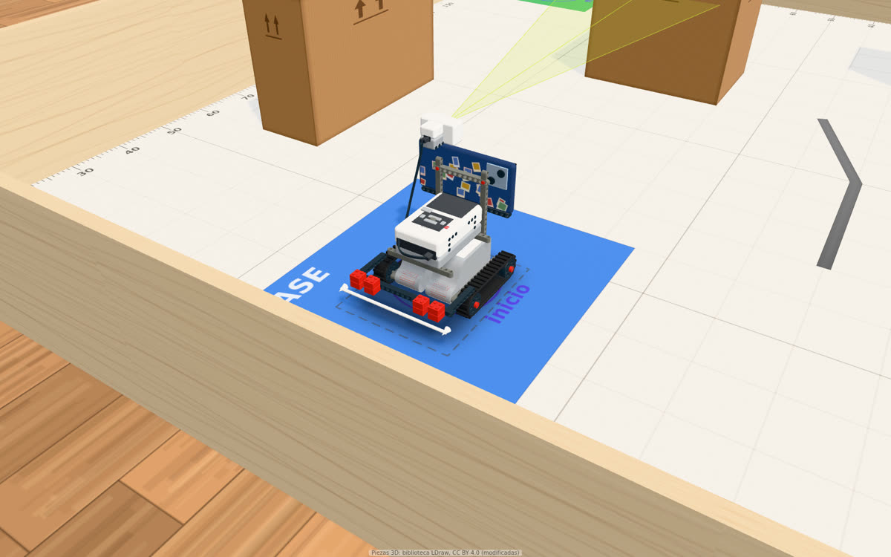

# spinecord

Habla con un robot LEGO EV3 a través de Claude. ¿No tienes robot? Tienes su gemelo en 3D, en tu navegador.

[English](README.md)



## Empezar

1. Abre un agente de código (Claude Code, Codex u otro) en macOS, Windows o Linux.
2. Pega esto:

   ```text
   Read https://raw.githubusercontent.com/JairoTorregrosa/spinecord/main/.claude/skills/setup-spinecord/SKILL.md and follow it.
   ```

3. El agente instala todo. Tú haces cinco cosas:

| Cuándo | Tú |
|---|---|
| Te pregunta | Dices si tienes un EV3, le pones nombre al robot si quieres y dices que sí al plan |
| Se abre una página del navegador | Entras a platform.claude.com, eliges la organización que tiene tus créditos y haces clic en Authorize |
| Te dice quién paga | Dices que sí |
| Te da una línea | La pegas en una terminal nueva y confías en la carpeta |
| Se abre la página 3D | Escribes lo que te dice y ves moverse al robot |

Nadie crea ni copia una API key.

## Habla con tu robot

Díselo con tus palabras:

- "Avanza hasta quedar a 15 cm de la pared."
- "Gira 90 grados a la izquierda."
- "¿Qué ves al frente?"
- "Para."

En la página 3D puedes levantar el robot, ponerle cajas en el camino, pulsar los botones de su ladrillo y cambiar la cámara.

## Hazlo tuyo

| Quieres | Dile a Claude |
|---|---|
| Que el gemelo sea el robot que armaste | "Este es mi robot, haz que el gemelo sea igual", con una foto |
| Otro nombre | "Llama al robot Rayo" |
| El EV3 de verdad | Conéctalo con el cable USB y di "ya tengo un EV3" |

Claude pregunta solo lo que la foto no muestra: qué puerto, qué lado, qué ruedas.

## Parar el robot

| Haz | Qué pasa |
|---|---|
| Di "para" | Todos los motores frenan. Esta es la forma de parar |
| Cierra Claude Code | Los motores se detienen |
| Desconecta el cable USB | El EV3 se detiene solo en un cuarto de segundo |

La primera vez con un robot de verdad, ten una mano cerca.

## Algo no funciona

Dile a tu agente de código: "spinecord no funciona. Corre su doctor y arréglalo."

## Más

Todo lo demás está escrito para agentes de código y desarrolladores: el [manual](docs/manual.md), [`AGENTS.md`](AGENTS.md), [`CONTRACT.md`](CONTRACT.md) y [`ARCHITECTURE.md`](ARCHITECTURE.md).

Licencia MIT. Las piezas 3D vienen de la biblioteca LDraw, CC BY 4.0 ([atribución](apps/twin-view/meshes/ATTRIBUTION.md)).
