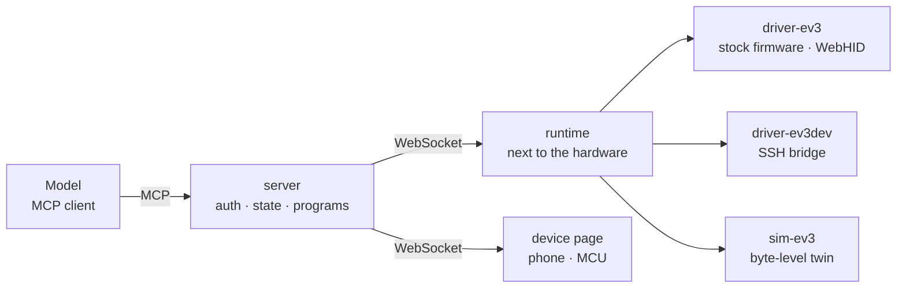

# spinecord

[](https://github.com/JairoTorregrosa/spinecord/actions/workflows/ci.yml)
[](LICENSE)


The spinal cord between a model and a robot. The model decides; spinecord runs the reflexes next to the hardware (bounded moves, `until` conditions, stop) and exposes one fixed set of generic MCP tools for real robots and their simulated twins.



| Package | Does |
|---|---|
| [`protocol`](packages/protocol) | types, state machines, wire protocol, tool catalog, validators |
| [`driver-ev3`](packages/driver-ev3) | LEGO EV3, stock firmware, direct commands over WebHID |
| [`driver-ev3dev`](packages/driver-ev3dev) | LEGO EV3 on ev3dev, SSH line bridge with on-brick watchdog |
| [`sim-world`](packages/sim-world) | JSON worlds, 2D physics, sensor models, declarative training |
| [`sim-ev3`](packages/sim-ev3) | byte-level EV3 firmware emulator: the twin runs the real driver |
| [`runtime`](packages/runtime) | runs tools next to the hardware: chunking, conditions, programs |
| [`server`](packages/server) | MCP server on Cloudflare Workers, Durable Objects and D1 |

Tested on a real EV3: [`docs/hardware-log.md`](docs/hardware-log.md).

## Tools

| Group | Tools |
|---|---|
| discover | `list_robots` `describe_robot` `describe_device` |
| sense | `read_device` `read_all` `sample_device` `wait_until` |
| act | `drive` `turn` `arc` `command_device` `stop` `reset_fault` |
| programs | `save_program` `list_programs` `get_program` `verify_program` `run_program` `retire_program` |
| episodes | `start_episode` `mark_episode` `end_episode` |
| admin | `take_control` `release_control` `stop_all` |

Full descriptions and schemas: [`packages/protocol/tools.ts`](packages/protocol/tools.ts). Behavior: [`CONTRACT.md`](CONTRACT.md). Boundaries: [`ARCHITECTURE.md`](ARCHITECTURE.md).

## Develop

```sh
bun install
bun run ci      # lint · format check · typecheck · boundaries · tests, in parallel
bun lint        # oxlint
bun fmt         # oxfmt (bun fmt:check only checks)
bun check       # tsc on every package
bun run test    # every package; SHARD=1/3 for one shard, --affected --base origin/main for what a diff reaches
bun run e2e     # relay + twin runner + MCP client on this machine, end to end (scripts/e2e-local.ts)
```

Run a twin against a relay (local relay: [`packages/server/scripts/dev.md`](packages/server/scripts/dev.md)); `--view` serves a live picture of it:

```sh
bun apps/twin-runner/main.ts --server ws://127.0.0.1:8787/ws/robot --token-file <file with the runtime token> --profile deployments/example/robots/r1.json --world packages/sim-world/examples/line-oval.json --view
```

`bun install` also installs the git hooks (lefthook: format, lint and gitleaks on staged files).

## Guarantees

- Every command is bounded on the device (time, degrees, or instant) and clamped to the robot profile.
- `stop` preempts everything; reads never change a device.
- A robot is a set of self-describing devices. New sensor = manifest, new robot = profile, no code.
