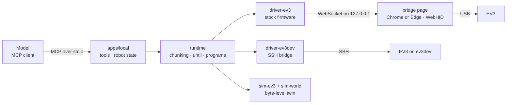

# spinecord

[](https://github.com/JairoTorregrosa/spinecord/actions/workflows/ci.yml)
[](LICENSE)


The spinal cord between a model and a robot. The model decides; spinecord runs the reflexes next to the hardware (bounded moves, `until` conditions, stop) and exposes one fixed set of generic MCP tools for real robots and their simulated twins. It runs on your computer: one process that an MCP client starts, with the MCP server, the runtime and the robots inside.



| Package | Does |
|---|---|
| [`protocol`](packages/protocol) | types, state machines, tool catalog, validators |
| [`driver-ev3`](packages/driver-ev3) | LEGO EV3, stock firmware, direct commands over WebHID |
| [`driver-ev3dev`](packages/driver-ev3dev) | LEGO EV3 on ev3dev, SSH line bridge with on-brick watchdog |
| [`sim-world`](packages/sim-world) | JSON worlds, 2D physics, sensor models, declarative training |
| [`sim-ev3`](packages/sim-ev3) | byte-level EV3 firmware emulator: the twin runs the real driver |
| [`runtime`](packages/runtime) | runs tools next to the hardware: chunking, conditions, programs |

| App | Does |
|---|---|
| [`local`](apps/local) | the server: MCP over stdio, the runtime and the robots (twin, ev3dev, stock EV3) in one bun process |
| [`robot-page`](apps/robot-page) | the bridge page a person opens in Chrome or Edge to lend a stock EV3 over USB; `local` serves it on `127.0.0.1` |

## Use it from Claude Code

One process on your laptop: the MCP server, the runtime and the robots. No account, no network service. Needs [bun](https://bun.sh) ≥ 1.3.14, git and Claude Code.

macOS or Linux (Terminal), Windows (PowerShell): the same three commands.

```sh
git clone https://github.com/JairoTorregrosa/spinecord
cd spinecord
bun install --filter @spinecord/local
```

`--filter @spinecord/local` installs what the server needs and nothing of the development toolchain: 6 packages, 16 MB. Measured on a fresh clone with an empty cache: 0.7 s on macOS (Apple M1 Pro), 1.1 s on a Windows CI runner. A plain `bun install` is 124 packages, 318 MB, 16 s on the same Mac.

Then register it with Claude Code, with the full path of the clone:

```sh
# macOS, Linux
claude mcp add spinecord -- bun "$PWD/apps/local/main.ts"
```

```powershell
# Windows PowerShell
claude mcp add spinecord -- bun "$PWD\apps\local\main.ts"
```

`/mcp` inside Claude Code shows `spinecord` connected with 14 tools. Ask: "list the robots, then drive until 15 cm from the wall".

Without arguments the server runs a simulated twin of the example robot (`r1-sim`) in an empty room. Arguments after `main.ts` choose the robots:

| Robot | Arguments |
|---|---|
| a twin | `--twin <robot.json> --world <world.json>` |
| a LEGO EV3 on stock firmware, USB | `--ev3 <robot.json>`, then open `http://127.0.0.1:8767/` in Chrome or Edge and press "Connect EV3". Keep that tab open; it may be covered or in the background |
| a LEGO EV3 on ev3dev | `--ev3dev <robot.json> --ssh <user@host>` (`--install-bridge` copies the bridge to the brick) |
| several at once | `--ev3 r.json --twin r.json --world w.json`, or `--config <file.json>` |

Robot file: [`deployments/example/robots/r1.json`](deployments/example/robots/r1.json). Worlds: [`apps/local/examples`](apps/local/examples), [`packages/sim-world/examples`](packages/sim-world/examples). Every option: `bun apps/local/main.ts --help`. Behavior: [`CONTRACT.md`](CONTRACT.md). The server logs on stderr (`claude --debug` shows it); closing Claude Code stops the motors.

Tested on a real EV3: [`docs/hardware-log.md`](docs/hardware-log.md).

Sense → act loops in one model turn (Claude Code Code Mode): [`docs/code-mode.md`](docs/code-mode.md).

## Tools

| Group | Tools |
|---|---|
| discover | `list_robots` `describe_robot` `describe_device` |
| sense | `read_device` `read_all` `sample_device` `wait_until` |
| act | `drive` `turn` `arc` `command_device` `stop` `reset_fault` |
| programs | `run_program` (the program inline, as data) |

Full descriptions and schemas: [`packages/protocol/tools.ts`](packages/protocol/tools.ts). Behavior: [`CONTRACT.md`](CONTRACT.md). Boundaries: [`ARCHITECTURE.md`](ARCHITECTURE.md).

## Develop

```sh
bun install
bun run ci      # lint · format check · typecheck · boundaries · tests, in parallel
bun lint        # oxlint
bun fmt         # oxfmt (bun fmt:check only checks)
bun check       # tsc on every package
bun run test    # every package and app; SHARD=1/3 for one shard, --affected --base origin/main for what a diff reaches
bun run bench   # latency of the path from a tool call to the robot, on the twin (bench/run.ts)
```

`bun install` also installs the git hooks (lefthook: format, lint and gitleaks on staged files).

## Guarantees

- Every command is bounded on the device (time, degrees, or instant) and clamped to the robot profile.
- `stop` preempts everything; reads never change a device.
- A robot is a set of self-describing devices. New sensor = manifest, new robot = profile, no code.
