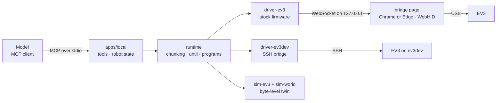

# spinecord

[](https://github.com/JairoTorregrosa/spinecord/actions/workflows/ci.yml)
[](LICENSE)


The spinal cord between a model and a robot. The model decides; spinecord runs the reflexes next to the hardware (bounded moves, `until` conditions, stop) and exposes one fixed set of generic MCP tools for real robots and their simulated twins. It runs on your computer: one process that an MCP client starts, with the MCP server, the runtime and the robots inside.



| Package | Does |
|---|---|
| [`protocol`](packages/protocol) | types, state machines, tool catalog, validators |
| [`driver-ev3`](packages/driver-ev3) | LEGO EV3, stock firmware, direct commands over WebHID |
| [`driver-ev3dev`](packages/driver-ev3dev) | LEGO EV3 on ev3dev, SSH line bridge with on-brick watchdog |
| [`sim-world`](packages/sim-world) | JSON worlds, 2D physics, sensor models, declarative training |
| [`sim-ev3`](packages/sim-ev3) | byte-level EV3 firmware emulator: the twin runs the real driver |
| [`runtime`](packages/runtime) | runs tools next to the hardware: chunking, conditions, programs |

| App | Does |
|---|---|
| [`local`](apps/local) | the server: MCP over stdio, the runtime and the robots (twin, ev3dev, stock EV3) in one bun process |
| [`robot-page`](apps/robot-page) | the bridge page a person opens in Chrome or Edge to lend a stock EV3 over USB; `local` serves it on `127.0.0.1` |
| [`twin-view`](apps/twin-view) | the 3D page a person opens to watch the twins move with the MCP calls, and to move the robot, set boxes down and press the brick's buttons; `local --view` serves it on `127.0.0.1` |
| [`peripheral-page`](apps/peripheral-page) | the page a person opens to lend a robot this computer's camera, microphone, speaker, screen and buttons; `local --pages` serves it on `127.0.0.1` ([docs](docs/peripheral-pages.md)) |

| Example | Does |
|---|---|
| [`assistant`](examples/assistant) | a personal robot assistant on the Claude Agent SDK, over the local server |

## Use it from Claude Code

One process on your laptop: the MCP server, the runtime and the robots. No account, no network service. Needs [bun](https://bun.sh) ≥ 1.3.14, git and Claude Code.

### Set up with your coding agent

A coding agent (Claude Code, Codex, or another one) can do the whole setup on macOS, Windows or Linux. It installs git, bun, the [`ant` CLI](https://platform.claude.com/docs/en/cli-sdks-libraries/cli/quickstart) and Claude Code, and logs in to the Console organization that holds your API credits with `ant auth login`, so no API key is made or copied. It registers spinecord in a folder of your own, `~/mi-robot`, and runs the doctor. It ends with Claude driving the robot while you watch. Without an EV3 you watch the tracked robot of [`deployments/orugas`](deployments/orugas) in its room, in the [3D view](#3d-view-of-the-twins). With an EV3, the robot goes on to USB. Give the agent this prompt:

```text
Read https://raw.githubusercontent.com/JairoTorregrosa/spinecord/main/.claude/skills/setup-spinecord/SKILL.md and follow it.
```

You act only at these moments:

1. Say if you have an EV3, and say yes to the whole plan, in one answer.
2. Sign in on the platform.claude.com page that opens, pick the organization with the credits, and click Authorize.
3. Say yes when the agent names the organization that pays.
4. Paste the launch line it gives you into a new terminal, and choose Yes when Claude Code asks if you trust the folder.
5. Type the request it gives you, watch the robot move on the 3D page that opens, and say that it moved.

The states and their checks are in [`.claude/skills/setup-spinecord/SKILL.md`](.claude/skills/setup-spinecord/SKILL.md). The steps after the clone are one script, `bun scripts/setup.ts <step>`. Each step checks first and acts only when needed, so a second run changes nothing. `bun scripts/setup.ts status` names the next step. The robots it registers are in [`robots.json`](.claude/skills/setup-spinecord/robots.json) next to the skill.

No coding agent yet? Install Claude Code ([setup](https://code.claude.com/docs/en/setup)), run `claude`, choose the Console account at the login, then "Sign in with your Console account", and pick the organization with the credits. That sign-in makes no API key ([authentication](https://code.claude.com/docs/en/authentication#sign-in-without-an-api-key)).

The steps below set spinecord up by hand.

### 1. Install

macOS or Linux (Terminal), Windows (PowerShell): the same three commands.

```sh
git clone https://github.com/JairoTorregrosa/spinecord
cd spinecord
bun install --filter @spinecord/local
```

`--filter @spinecord/local` installs what the server needs and nothing of the development toolchain: 6 packages, 16 MB. Measured on a fresh clone with an empty cache: 0.7 s on macOS (Apple M1 Pro), 1.1 s on a Windows CI runner. A plain `bun install` adds the development toolchain and the Claude Agent SDK of the [example assistant](examples/assistant): 202 packages, 456 MB on the same Mac.

### 2. Register it with Claude Code

Still in the `spinecord` folder, ask the server for the command of this computer:

```sh
bun apps/local/main.ts --print-add
```

It prints one line, with the full path of your clone in quotes. On a Mac it looks like this:

```sh
claude mcp add -s user spinecord -- bun "/Users/you/spinecord/apps/local/main.ts"
```

Copy the printed line, paste it in the same terminal and press Enter. On Windows the printed line is the same for PowerShell and cmd.exe.

- `-s user` registers the server for every folder of your user. Without it Claude Code knows the server only in the folder where the command ran.
- The path is absolute, so the server starts from whatever folder Claude Code is in. Typed by hand on macOS or Linux, the line is `claude mcp add -s user spinecord -- bun "<full path of the clone>/apps/local/main.ts"`. On Windows use the printed line: it writes the separator as `"--"`, because PowerShell drops a bare `--` when `claude` was installed with npm, and it holds the path in full, because cmd.exe does not expand `$PWD`.

### 3. Start Claude Code in a folder of your own

```sh
mkdir my-robot
cd my-robot
claude
```

Make the folder anywhere outside the clone (your home folder, the desktop). Inside the clone Claude Code reads this repository's `AGENTS.md` and source, which are written for people who change spinecord, not for driving a robot.

`/mcp` inside Claude Code shows `spinecord` connected with 16 tools.

### 4. Allow its tools once

Claude Code asks before the first use of each tool, and spinecord has 16. A script that drives the robot ([Code Mode](docs/code-mode.md)) waits at each of those questions. Allow the server's tools once: in the Claude Code you just started type `/permissions`, choose Allow, add the rule `mcp__spinecord`. The same rule as a line of `~/.claude/settings.json`:

```json
{ "permissions": { "allow": ["mcp__spinecord"] } }
```

Then ask: "list the robots, then drive until 15 cm from the wall".

### Check a computer

In the `spinecord` folder, with the robot arguments of your registration:

```sh
bun apps/local/main.ts --doctor --ev3
```

It changes nothing and starts no robot. It checks bun, Chrome or Edge, the registration in Claude Code (that this folder's sessions see it, and that it runs this clone's `main.ts`; at local or project scope only sessions opened in this folder see it, which is `ok`), that no other spinecord holds the ports, that the robot files parse, and with `--lan` the private address and the firewall. Add `--assistant` to check who pays for the [example assistant](examples/assistant): it names the variables that are set, never their values, and with `ANTHROPIC_PROFILE` it asks `ant auth status` whether that profile is logged in. Each line is `ok`, `warn` or `fail`, why, and after `->` the command that fixes it. The last line is `doctor: ok`, or `doctor: <n> to fix` with the number of `fail` lines and exit code 1; a `warn` alone keeps `doctor: ok`.

### Choose the robots

Without arguments the server runs a simulated twin of the example robot (`r1-sim`) in an empty room. Arguments after `--print-add` choose the robots:

| Robot | Arguments |
|---|---|
| the twin of the example robot | none, or `--twin` (`--world <world.json>` for another room) |
| a LEGO EV3 on stock firmware, USB | `--ev3`, then open `http://127.0.0.1:8767/` in Chrome or Edge and press "Connect EV3". Keep that tab open; it may be covered or in the background |
| a LEGO EV3 on ev3dev | `--ev3dev --ssh robot@HOST --install-bridge`, after the ssh key below |
| an EV3 and its twin | `--ev3 --twin` |
| the twin of the example arm: two free motors and a touch sensor, no wheels | `--twin deployments/example/robots/arm.json` |
| a robot file of your own | `--ev3 <robot.json>`, `--twin <robot.json>`, `--ev3dev <robot.json>` |
| devices lent by browser pages, beside the twin | `--twin --pages` ([Peripheral pages](#peripheral-pages-devices-lent-by-a-browser)) |
| any of these, and the twins in 3D in a browser | add `--view` ([3D view](#3d-view-of-the-twins)) |
| several robots of a kind | `--config <file.json>` |

The registration holds the arguments. To switch robots, remove it and add it again, then start Claude Code again:

```sh
claude mcp remove -s user spinecord
bun apps/local/main.ts --print-add --ev3 --twin
```

and run the line it prints.

`--twin`, `--ev3` and `--ev3dev` without a file use the example robot, [`deployments/example/robots/r1.json`](deployments/example/robots/r1.json): the LEGO EV3 educator base, large motors on B and C driven as one pair, heading from its gyro. The other example, [`deployments/example/robots/arm.json`](deployments/example/robots/arm.json), declares no `pair` and no `drivetrain`: its motors are devices for `command_device`, and `drive`, `turn` and `arc` answer `unsupported`. A relative path is taken from the clone, never from the folder Claude Code runs in; a file that is not there ends the start with its full path. Worlds: [`apps/local/examples`](apps/local/examples), [`packages/sim-world/examples`](packages/sim-world/examples). Every option: `bun apps/local/main.ts --help`. Behavior: [`CONTRACT.md`](CONTRACT.md). The server logs on stderr (`claude --debug` shows it); `--log-file <path>` keeps the log in a file ([Troubleshooting](#troubleshooting)).

### 3D view of the twins

`--view` serves a 3D view of every twin on `http://127.0.0.1:8769/` (`--view-port <n>` for another port): open it in a browser while a model drives the twin. The robot moves as the tools move it, its tracks or wheels and motor hubs turn with the tachos, the brick shows its LED and screen, the distance sensor draws its rays, and every call appears as it begins and ends with its summary. The page plays the brick's tones and says `sim.speaker`'s phrases once sound is turned on. The person there can act on the twin as on a robot on the floor: drag the robot to pick it up and set it down (the gyro feels the turn), set boxes down and take them away, restore the room, and hold the brick's buttons. What the page shows carries no noise and changes nothing the robot reads.

```sh
bun apps/local/main.ts --print-add --twin --view
```

How a twin looks comes from its world file: `extensions.view` says tracks or wheels, where the brick, a phone and each sensor sit, a bumper and a label ([`apps/twin-view/src/look.ts`](apps/twin-view/src/look.ts)); without it the page draws an educator base. [`deployments/orugas`](deployments/orugas) is a tracked EV3 with a phone at the front and its room.

### Peripheral pages: devices lent by a browser

A *peripheral page* is a browser page that joins a robot of the server and lends it devices of the computer or the phone it runs on: a camera, a microphone, a speaker, a screen, touch buttons. The page declares each device as a manifest, and the model reads and commands it with the same tools as a motor or a sensor: `describe_robot` lists the page under `pages`, `read_device` returns a camera frame as an image, `command_device` runs a speaker's `speak` or a microphone's `listen`, and a pushed touch button can end a `drive … until` or a `wait_until`. No tool is added. A page never moves the robot, and the person at the page can pause it at any moment: its devices then answer `device_offline`, and a move guarded by one of its channels is braked.

`--pages` turns pages on for every robot of the server and adds the robot `pages`, which has no body: it is online from the start, with no device until a page joins ([`deployments/example/robots/pages.json`](deployments/example/robots/pages.json)).

```sh
bun apps/local/main.ts --print-add --twin --pages
```

The server then listens for pages on `http://127.0.0.1:8768/` (`--page-port <n>` for another port), on this computer only unless `--lan` is given ([Peripheral pages on a phone](#peripheral-pages-on-a-phone)), and `list_robots` gives each robot a `join` sentence to tell the person. Open that address in Chrome or Edge on this computer, pick the page's name and tap **Lend this device**: the page ([`apps/peripheral-page`](apps/peripheral-page)) lends the robot this computer's camera, microphone, speaker, a screen for its face and four buttons, and shows a banner with Pause and Stop lending while the camera or the microphone is lent. It joins with the pairing token the server writes into the page it serves; the token changes at every start. What each device offers, the privacy rules, and how to add a device of your own in a few lines of JavaScript, loaded from a folder with `--page-ext` ([`deployments/example/page-ext`](deployments/example/page-ext)): [`docs/peripheral-pages.md`](docs/peripheral-pages.md). Any client that speaks the protocol of [`CONTRACT.md`](CONTRACT.md) §2.4 can join too, as the test client [`apps/local/test/pages.ts`](apps/local/test/pages.ts) does.

### Peripheral pages on a phone

`--lan` lets a phone on the same network join over HTTPS, with its join link as a QR code: how to pair an iPhone or an Android phone in under 5 minutes, what fails and the exits, in [`docs/peripheral-pages.md`](docs/peripheral-pages.md#pairing-a-phone---lan).

### An EV3 on ev3dev: the ssh key first

The server runs `ssh` without a keyboard: it cannot type a password and cannot answer the question about a new host key. Set both up once per computer and brick. `HOST` is the brick's name or address on your network (the brick shows its address at the top of its screen); `robot` is ev3dev's user, and its password is `maker` unless you changed it.

macOS, Linux:

```sh
ssh-keygen -t ed25519      # only when you have no key yet; press Enter at each question
ssh-copy-id robot@HOST   # answer "yes" to the host key, then type the brick's password
ssh robot@HOST exit      # passes when it ends without asking anything
```

Windows PowerShell (no `ssh-copy-id` there):

```powershell
ssh-keygen -t ed25519
type $env:USERPROFILE\.ssh\id_ed25519.pub | ssh robot@HOST "mkdir -p ~/.ssh && cat >> ~/.ssh/authorized_keys && chmod 700 ~/.ssh && chmod 600 ~/.ssh/authorized_keys"
ssh robot@HOST exit
```

Then register with `--ev3dev --ssh robot@HOST --install-bridge`: `--install-bridge` copies the bridge (one Python file) to the brick. A brick that is off or out of reach does not stop the server: `list_robots` shows it `offline` with what to check, the server keeps trying, and the robot is `online` when the brick answers.

### Check the direction before the first run

Put the robot on the floor with free space ahead and ask: "drive forward 5 cm". Look at it. If it went backward, the motors are mounted the other way round: open the robot file (`deployments/example/robots/r1.json` in your clone, or your own file), change `"forward_sign": 1` to `"forward_sign": -1` under `profile.drivetrain`, save, and start Claude Code again.

### Stopping the robot

| What you do | What happens |
|---|---|
| Say "stop the robot" | The `stop` tool: it preempts every call, brakes every motor, checks that they read speed 0 and reports `motors_stopped`. This is the way to stop |
| Press `Esc` in Claude Code | Claude Code interrupts the call. The server stops the robot, with the same stop, when Claude Code cancels the call. That Claude Code does so on `Esc` is not checked with a real session (the `Esc` row of the checklist in [`docs/hardware-log.md`](docs/hardware-log.md)): after `Esc`, say "stop the robot" |
| Close Claude Code | The server stops every motor before it exits |
| Stock EV3: close the bridge tab or pull the USB cable | No further command reaches the brick. The one that is running ends by itself: every motion command is limited to 250 ms on the brick |
| ev3dev: the network or the computer goes away | A watchdog on the brick brakes every motor after 1 s without a message. A second process on the brick brakes them when the bridge itself is killed |

One Claude Code session per robot. With `-s user` every Claude Code session on the computer starts its own server with the same robots. A second session opens a second link to the same ev3dev brick, and when either session ends, the brick brakes every motor, also in the middle of a move of the other session. With `--ev3` the second session's server does not start: the page's port is taken.

Keep a hand near the robot on a first run. These paths are tested against the twin, the byte-level EV3 emulator and a fake ev3dev brick; what has run on a real brick is in the next section.

### What has run on a real brick

| Path | On a real brick |
|---|---|
| Stock EV3 over USB through the bridge page (`--ev3`) | not run |
| EV3 on ev3dev with bridge version 7, the one in this repository (`--ev3dev`): version 6 plus loops on the brick (`run_loop` with `runs_on: device`), the `power` command and the guard's deadman. A loop needs it; on an older bridge `run_loop` answers `misconfigured` with the reinstall hint | not run |
| EV3 on ev3dev with bridge version 6: version 5 plus NXT sensors, generic sensors from sysfs and `hardware.ir_channel`. A robot file whose `ir_channel` is not 1 needs it; the other sensors show as `unknown` on an older bridge | not run |
| EV3 on ev3dev with bridge version 5: version 4 plus a hello that may leave out `pair`. A robot without a `pair` needs it; a robot with one runs on version 4 too | not run |
| EV3 on ev3dev with bridge version 4 | run on 2026-11-22: stop, `Esc`, the square, `kill -9` of the bridge, the guard |
| EV3 on ev3dev with a bridge before version 4 | run on 2026-11-21 |

The dated log and the checklist of what to run: [`docs/hardware-log.md`](docs/hardware-log.md).

Sense → act loops in one model turn (Claude Code Code Mode): [`docs/code-mode.md`](docs/code-mode.md).

## Build an assistant on it

[`examples/assistant`](examples/assistant) is a personal robot assistant on the Claude Agent SDK: one file of plain words says who it is and what its mission is, and a short program connects Claude to this server. It chats in a terminal, or wakes up on its own every N seconds and acts on its mission. It runs against the twin with no robot.

## Tools

| Group | Tools |
|---|---|
| discover | `list_robots` `describe_robot` `describe_device` |
| sense | `read_device` `read_all` `sample_device` `wait_until` |
| act | `drive` `turn` `arc` `command_device` `stop` `reset_fault` |
| programs | `run_program` (the program inline, as data) |
| loops | `run_loop` `supervise_loop` (a control law at a fixed rate next to the hardware, which the model supervises: [`docs/loops.md`](docs/loops.md)) |

Full descriptions and schemas: [`packages/protocol/tools.ts`](packages/protocol/tools.ts). Behavior: [`CONTRACT.md`](CONTRACT.md). Boundaries: [`ARCHITECTURE.md`](ARCHITECTURE.md).

## Develop

```sh
bun install
bun run ci      # lint · format check · typecheck · boundaries · tests, in parallel
bun lint        # oxlint
bun fmt         # oxfmt (bun fmt:check only checks)
bun check       # tsc on every package
bun run test    # every package and app; SHARD=1/3 for one shard, --affected --base origin/main for what a diff reaches
bun run bench   # latency of the path from a tool call to the robot, on the twin (bench/run.ts)
```

`bun install` also installs the git hooks (lefthook: format, lint and gitleaks on staged files).

## Troubleshooting

The server writes one JSON object per line on stderr (`claude --debug` shows it). To keep those lines, register the server with `--log-file <path>`: it appends every one of them to that file as well, across restarts. In the `spinecord` folder, on macOS, Linux and Windows (PowerShell) alike:

```sh
claude mcp remove -s user spinecord
bun apps/local/main.ts --print-add --log-file ~/spinecord.log
```

Run the line it prints, then start Claude Code again. Put the robot arguments of your registration (`--ev3`, `--twin`, …) on the same line, next to `--log-file`. The printed line holds the file's full path: `~` is your home folder (`/Users/you/spinecord.log` on a Mac, `C:\Users\you\spinecord.log` on Windows), and a relative path is taken from the clone. The server creates the file's folder, and it does not start when the file cannot be opened. When a write fails later (a full disk), the server keeps running and logs on stderr alone, after one `"ev":"log_file_failed"` line there. The line being written when the disk filled stays cut off at the end of the file. Keep the file on a local disk: every line is written as it happens, so a folder that stalls (a network or cloud-synced folder) stalls the server too.

Read the file while the server runs:

| | Follow it | Search it |
|---|---|---|
| macOS, Linux | `tail -f ~/spinecord.log` | `grep '"ev":"call"' ~/spinecord.log` |
| Windows PowerShell | `Get-Content $HOME\spinecord.log -Wait` | `Select-String '"ev":"call"' $HOME\spinecord.log` |

Every tool call leaves one line when it is answered:

```json
{"ev":"call","ts":"2026-11-22T08:19:28.089Z","tool":"drive","robot_id":"r1-sim","ok":true,"code":null,"reason":"completed","ms":350,"trace_id":null,"moved":true}
```

| Field | Meaning |
|---|---|
| `tool`, `robot_id` | what was called, on which robot (cut at 64 characters) |
| `ok`, `code` | the outcome; `code` is the error code when `ok` is false |
| `reason` | why a move or a wait ended (`completed`, `condition_met`, `clamped`, `stalled`, `preempted`, `timeout`); the `outcome` of `run_program` |
| `ms` | how long the call took |
| `moved` | whether a moving operation was sent to the robot |
| `trace_id` | set when an `internal` error is behind the answer |

Arguments, results and images are never logged.

| Question | Look for |
|---|---|
| What did the model call, and what failed? | `grep '"ev":"call"' ~/spinecord.log`, then `grep '"ok":false'` |
| An error message says `(trace_id ab12cd34)` | `grep ab12cd34 ~/spinecord.log`: the `"ev":"internal"` line has the stack |
| Did the robot move during a call that failed? | `"moved":true` on its line; read the robot (`read_all`) before moving again |
| Why is a robot offline or in fault? | the `"ev":"link"` and `"ev":"activity"` lines carry `from`, `to` and `why` |

The format is part of the contract: [`CONTRACT.md`](CONTRACT.md) §6, "Call log".

## Guarantees

- Every command is bounded on the device (time, degrees, or instant) and clamped to the robot profile.
- `stop` preempts everything; reads never change a device.
- A robot is a set of self-describing devices. New sensor = manifest, new robot = profile, no code.
