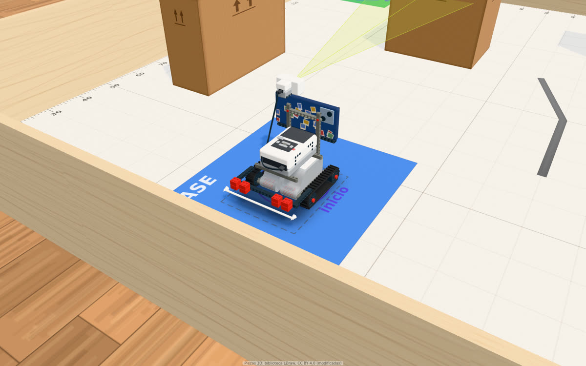

# spinecord

Talk to a LEGO EV3 robot through Claude. No robot? You get its twin in 3D, in your browser.

[Español](README.es.md)



## Start

1. Open a coding agent (Claude Code, Codex or another one) on macOS, Windows or Linux.
2. Paste this:

   ```text
   Read https://raw.githubusercontent.com/JairoTorregrosa/spinecord/main/.claude/skills/setup-spinecord/SKILL.md and follow it.
   ```

3. The agent installs everything. You do five things:

| When | You |
|---|---|
| It asks | Say if you have an EV3, give the robot a name if you want, and say yes to the plan |
| A browser page opens | Sign in to platform.claude.com, pick the organization with your credits, click Authorize |
| It names who pays | Say yes |
| It gives you a line | Paste it into a new terminal and trust the folder |
| The 3D page opens | Type what it tells you and watch the robot move |

Nobody makes or copies an API key.

## Talk to your robot

Say it in your own words, in your language:

- "Drive until you are 15 cm from the wall."
- "Turn left 90 degrees."
- "What do you see in front of you?"
- "Stop."

In the 3D page you can pick the robot up, put boxes in its way, press the buttons of its brick and change the camera.

## Make it yours

| You want | Say to Claude |
|---|---|
| The twin to be the robot you built | "This is my robot, make the twin match it", with a photo |
| Another name | "Call the robot Rayo" |
| The real EV3 | Plug it in with the USB cable and say "I have an EV3 now" |
| Another map | "Use the laberinto map" (or pista, slalom, reparto, bodega, sala) |

Claude asks only what the photo does not show: which port, which side, which wheels.

## Stop the robot

| Do | What happens |
|---|---|
| Say "stop" | Every motor brakes. This is the way to stop |
| Close Claude Code | The motors stop |
| Pull the USB cable | The EV3 stops by itself |

Keep a hand near a real robot the first time.

## Something does not work

Say to your coding agent: "spinecord does not work. Run its doctor and fix it."

## More

Everything else is written for coding agents and developers: the [manual](docs/manual.md), [`AGENTS.md`](AGENTS.md), [`CONTRACT.md`](CONTRACT.md) and [`ARCHITECTURE.md`](ARCHITECTURE.md).

MIT license. The 3D parts come from the LDraw library, CC BY 4.0 ([attribution](apps/twin-view/meshes/ATTRIBUTION.md)).
