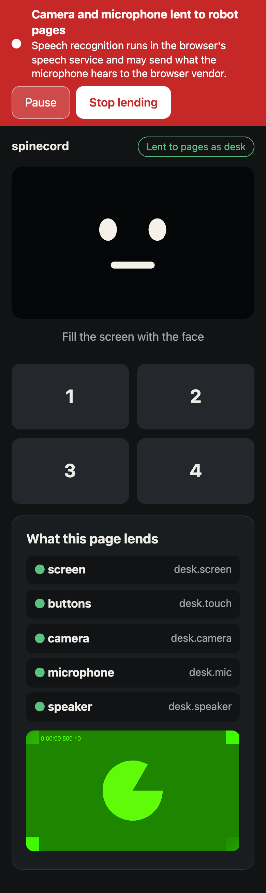

# Peripheral pages

A peripheral page is a browser page that lends a robot of the spinecord process the devices of the computer or phone it runs on: eyes, ears, a voice, a face and buttons. No tool is added. The model finds the devices with `describe_robot` and `describe_device`, reads them with `read_device`, `read_all` and `wait_until`, commands them with `command_device`, and names them in `until` and in programs, like any other device. The contract is CONTRACT.md §2.4; the page is `apps/peripheral-page`.

## Start it

```sh
bun apps/local/main.ts --twin --pages
```

`--pages` turns the page listener on (`127.0.0.1`, port 8768; `--page-port <n>` picks another) and adds a robot with no body, `pages`, whose every device a page lends. Every other robot of the process takes pages too. `list_robots` gives each robot a `join` sentence that says what to open.

On this computer open `http://127.0.0.1:8768/` in Chrome or Edge, choose the page's name (`desk` by default, `phone` on a touch screen) and, when the process has more than one robot, the robot. Then tap **Lend this device**. That one tap asks the browser for the camera and the microphone, starts the page's audio and its speech voices, and joins. Refuse the camera or the microphone and the robot gets the rest: the page lists what it could not lend, and why, and so does `describe_robot`.

The page while it lends, on a phone and on a laptop:

 

A join link's fragment can set the name, the robot and the language: `http://127.0.0.1:8768/#name=desk&robot=r1-sim&lang=en-US`.

## What the page lends

Devices are `<page name>.<id>`. With the name `desk`:

| device | kind | role | channels | commands |
|---|---|---|---|---|
| `desk.camera` | camera | eyes | `frame` (one JPEG per read, at most 2 per second), `width_px`, `height_px`, `facing` | `configure{max_side_px 160..1280, quality 0.3..0.9, facing?}` |
| `desk.mic` | microphone | ears | `listening`, `last_transcript`, `last_match`, `heard_count`, `level_pct` (all pushed) | `listen{max_ms 500..15000, lang?, expect?}` |
| `desk.speaker` | speaker | voice | `speaking`, `last_spoken`, `spoken_count` (pushed) | `speak{text, lang?, voice?, rate_wpm?}`, `tone{frequency_hz, duration_ms}` |
| `desk.screen` | display | face | `showing` (pushed) | `text{lines}`, `clear{}`, `face{expression}`, `color{color, ms}` |
| `desk.touch` | touch_panel | touch | `b1`..`b4`, `b1_presses`..`b4_presses` (pushed) | `set_labels{labels}` |

Each one is declared only where it works:

- **Camera**: where the person allowed it and the browser can take a frame from its track (`ImageCapture`). A frame is taken when a read asks for one, never streamed.
- **Microphone**: `listen` only where the browser has speech recognition (Chrome and Edge); `level_pct` only where the page has an audio worklet. A microphone with neither is not lent. `listen` waits for one phrase, never continuously. `expect` lists phrases the page matches itself, case and accents ignored, as a substring; `last_match` then holds the phrase, so a program tests `last_match eq "yes"` with no model turn. The language is `es-ES` unless the command's `lang` or the link's `#lang=` says otherwise. On desktop Chrome and Edge the recognition runs in the browser vendor's speech service and may send it the audio; the page's banner says so.
- **Speaker**: `speak` with the voices this browser lists (its `lang` and `voice` enums are what `describe_device` shows: never assume one), `tone` through Web Audio.
- **Screen**: text, a face (`neutral`, `happy`, `sad`, `thinking`, `listening`, `speaking`, plus any an extension adds) or a color. **Fill the screen with the face** makes it the robot's face, full screen.
- **Buttons**: four large buttons, pressed with a finger or the mouse.

## Privacy

- Nothing is lent before the tap, and nothing is stored: no frame, no audio, no transcript. A frame or a phrase goes only to the program that asked, in the result of its call.
- While the camera or the microphone is lent, a red banner says so. It flashes on each frame taken and says "listening…" for the whole of a `listen`. **Pause** makes every device of the page answer `device_offline` until **Resume**. **Stop lending** closes the camera and the microphone and takes them out of the robot.
- Point a camera at the table, not at people who did not agree to it.

## A page in the background

`apps/local/bench/peripheral-page.ts` asks for a frame, a `speak` and a `listen` with the page's tab in front, covered by another window and hidden behind another tab, in Chrome with its fake camera and microphone (results in `apps/local/bench/results/peripheral-page*.json`). Measured on macOS with Chrome: frames and `speak` work in all three states; a tab the browser reports hidden encodes a frame about once a second, so that frame's `age_ms` is about 1000. The `listen` of that run timed out in all three states: Chrome's recognizer started and opened audio but heard no sound from the fake microphone, so whether a covered or hidden tab still recognizes speech is not measured yet. When a page stops answering, its devices answer `device_offline` and say what the person must do.

## Add a device: the extension API

The page exposes `window.spinecord`. The shipped kinds use the same `device()` call.

```js
spinecord.device({
  id,          // local id, e.g. "door"
  kind,        // open string
  description, // one sentence for the model, at most 300 characters
  roles,       // optional: roles this device proposes, e.g. ["eyes"]
  channels,    // ChannelSpec[]; pushed: true for values the page reports by itself
  commands,    // CommandSpec[]; moves: false, bound "instant" or "ms" up to 30000
  available,   // optional: () => true | "why not", asked when the manifest is built
  read,        // optional: (channels) => ({ channel: value }) for channels that are not pushed
  run,         // optional: (command, args, signal) => measured, or spinecord.ended(reason, measured)
  stop,        // optional: () => void, called by the robot's stop
});
spinecord.push(id, { channel: value });     // a pushed channel changed
spinecord.screen(name, (root, args) => {}); // a face: the screen's face command gains `name`
spinecord.cameraFrame();                     // a Promise of the lent camera's current frame (ImageBitmap)
throw new spinecord.PageError("busy", "…");  // a command or read that fails with a contract code
```

A device added after the page joined is announced at once. The process checks the manifest's shape and bounds (CONTRACT §2.4) and exposes it; nothing on the server changes.

### Example: a door sensor from a tap

A phone taped beside a door, a strip of paper on the door that touches the screen while the door is shut:

```js door.js
const el = document.body.appendChild(Object.assign(document.createElement("div"), { className: "sc-pad" }));
let opened = 0;
spinecord.device({
  id: "door",
  kind: "contact",
  description: "A contact pad on this screen: closed is true while something touches it.",
  channels: [
    { name: "closed", type: "boolean", pushed: true, description: "true while the pad is touched." },
    { name: "opened_count", type: "number", pushed: true, description: "Times the pad was released since the page joined." },
  ],
  commands: [],
});
el.addEventListener("pointerdown", () => spinecord.push("door", { closed: true }));
el.addEventListener("pointerup", () => spinecord.push("door", { closed: false, opened_count: ++opened }));
```

To try it, paste it into the browser's DevTools console on the page after lending (give the pad a size first, for example `el.style.cssText = "height:40vh;background:#334"`). The model then has `desk.door`: `wait_until {device: "desk.door", channel: "closed", op: "eq", value: false}`, or `drive … until` the same condition. Loading such files from a folder at start is a later step (`--page-ext`).
