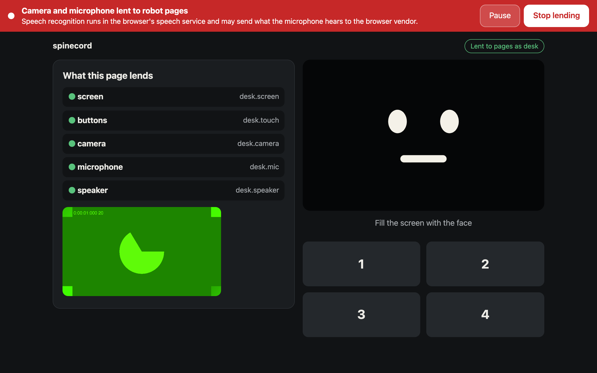

# Peripheral pages

A peripheral page is a browser page that lends a robot of the spinecord process the devices of the computer or phone it runs on: eyes, ears, a voice, a face and buttons and, on a phone, motion sensors, vibration and a torch. No tool is added. The model finds the devices with `describe_robot` and `describe_device`, reads them with `read_device`, `read_all` and `wait_until`, commands them with `command_device`, and names them in `until` and in programs, like any other device. The contract is CONTRACT.md §2.4; the page is `apps/peripheral-page`.

## Start it

```sh
bun apps/local/main.ts --twin --pages
```

`--pages` turns the page listener on (`127.0.0.1`, port 8768; `--page-port <n>` picks another) and adds a robot with no body, `pages`, whose every device a page lends. Every other robot of the process takes pages too. `list_robots` gives each robot a `join` sentence that says what to open.

On this computer open `http://127.0.0.1:8768/` in Chrome or Edge, choose the page's name (`desk` by default, `phone` on a touch screen) and, when the process has more than one robot, the robot. Then tap **Lend this device**. That one tap asks the browser for the camera, the microphone and, where the browser asks (Safari on iOS), the motion sensors, starts the page's audio and its speech voices, keeps the screen on, and joins. Refuse any of them and the robot gets the rest: the page lists what it could not lend, and why, and so does `describe_robot`.

The page while it lends, on a phone and on a laptop:

 

A join link's fragment can set the name, the robot and the language: `http://127.0.0.1:8768/#name=desk&robot=r1-sim&lang=en-US`.

## Pairing a phone (`--lan`)

A phone lends its camera, microphone and voice only to a page it opened over HTTPS: a browser offers them to a secure context alone. `--lan` gives the page one. The server listens, besides `127.0.0.1`, on the computer's address on its network, over HTTPS, port 8769 (`--page-port` + 1), under the name `a-b-c-d.local-ip.sh` for the address a.b.c.d. [local-ip.sh](https://local-ip.sh) is a public DNS service that answers that name with that address and publishes a Let's Encrypt certificate for `*.local-ip.sh`, with its key; the server fetches both at start and keeps them in the computer's cache folder (`spinecord/lan-cert.json`) until the certificate expires. Nothing goes to the phone but the page: no app, no certificate to install.

```sh
bun apps/local/main.ts --print-add --twin --pages --lan
```

Pairing a phone, iPhone or Android, in under 5 minutes, on a network of your own: the phone's hotspot.

1. On the phone, turn on its hotspot. iPhone: Settings > Personal Hotspot > Allow Others to Join (turn on Maximize Compatibility if the computer does not see it). Android: Settings > Network & internet > Hotspot & tethering > Wi-Fi hotspot (the menu names vary by maker).
2. Join that Wi-Fi from the computer. Then start Claude Code: the server starts with it and listens on the hotspot address. With more than one network on the computer (Wi-Fi and a cable), it takes the one of the default route; `--lan-interface <name|address>` picks another.
3. On the computer open `http://127.0.0.1:8768/console`. It shows one QR code per robot, and whether this computer resolves the name. The same codes are on the server's stderr.
4. Point the phone's camera at a code and open the link in Safari (iPhone) or Chrome (Android), not in an app's own browser view. The link carries the pairing token of this start in its `#` part, which the browser never sends to a server; whoever has the link can lend the robot their devices, so share it only with your own phones.
5. On the page, tap **Lend this device**, allow the camera and the microphone, and keep the screen on.

The token changes at every start, and so does the link when the computer changes network: scan again. Five wrong tokens from one address within a minute and that address is refused for a minute. Through a tunnel every page reaches the server from `127.0.0.1`, so there the refusal holds for every page of the tunnel.

What fails, and the exits:

- **The name does not resolve.** Some routers and DNS resolvers drop answers that point a public name at a private address (DNS rebinding protection). The server's stderr and the console say so when this computer's resolver does it; the phone then reports that it cannot find the server. On a phone's own hotspot the name goes to the carrier's DNS; whether each carrier passes it is not verified yet ([`docs/hardware-log.md`](hardware-log.md)). Exits: another network, a certificate of your own, or a tunnel (below).
- **The network isolates its clients** (many guest, office and event networks): the phone cannot reach the computer at all, whatever the certificate. Exits: the phone's hotspot with the computer joined to it, or a tunnel.
- **No certificate at start** (no internet, the service down): the start ends with exit code 1 and a message naming `--lan-cert`. Anyone can have that public certificate revoked, since its key is public: if phones refuse it, delete `lan-cert.json` from the cache folder to fetch the service's newer one, or use your own.
- **A certificate of your own:** [mkcert](https://github.com/FiloSottile/mkcert) makes one for the computer's address (`mkcert -install`, then `mkcert <address>`), and `--lan-cert <address>.pem <address>-key.pem` serves it at `https://<address>:8769/`, with no DNS at all. The phone must trust mkcert's root: send it `rootCA.pem` (`mkcert -CAROOT` says where it is); on an iPhone install the profile, then turn on full trust in Settings > General > About > Certificate Trust Settings; on Android install it under Settings > Security > Encryption & credentials > Install a certificate > CA certificate. That root can sign for any site on that phone: keep its key on the computer. For a certificate of a name, add `--lan-host <name>`.
- **A tunnel you run** works on any network, the phone anywhere: `cloudflared tunnel --url http://127.0.0.1:8770` (or pinggy) gives an `https://` address; start the server with `--page-origin <that address>`, and pages join through it at the listener on `127.0.0.1:8770` (`--page-port` + 2). Every frame and transcript then crosses the tunnel's operator and the internet. A quick tunnel's address changes at each start, so register the server again with the new one.
- **macOS's firewall**, when it is on, asks whether bun may accept incoming connections: allow it (System Settings > Network > Firewall > Options). With "Block all incoming connections" set, no phone can connect.
- **Windows asks about the firewall** the first time the server listens beyond `127.0.0.1`: allow bun on private networks. A hotspot may be classified as public: set it to private (Settings > Network & internet > Wi-Fi > the network > Network profile type) or the phone cannot connect. A computer without administrator rights may not be able to allow it; the tunnel needs no inbound rule.

TLS here gives the phone a secure context, not secrecy: the key of the local-ip.sh certificate is public, so someone on the same network who can place themselves between the phone and the computer can read the traffic. The token keeps strangers from joining. On a shared network, do not lend a camera. Whether all of this works on real phones is not verified yet: [`docs/hardware-log.md`](hardware-log.md).

## What the page lends

Devices are `<page name>.<id>`. With the name `desk` on a computer, and `phone` on a phone for the last three:

| device | kind | role | channels | commands |
|---|---|---|---|---|
| `desk.camera` | camera | eyes | `frame` (one JPEG per read, at most 2 per second), `width_px`, `height_px`, `facing` | `configure{max_side_px 160..1280, quality 0.3..0.9, facing?}` |
| `desk.mic` | microphone | ears | `listening`, `last_transcript`, `last_match`, `heard_count`, `level_pct` (all pushed) | `listen{max_ms 500..15000, lang?, expect?}` |
| `desk.speaker` | speaker | voice | `speaking`, `last_spoken`, `spoken_count` (pushed) | `speak{text, lang?, voice?, rate_wpm?}`, `tone{frequency_hz, duration_ms}` |
| `desk.screen` | display | face | `showing` (pushed) | `text{lines}`, `clear{}`, `face{expression}`, `color{color, ms}` |
| `desk.touch` | touch_panel | touch | `b1`..`b4`, `b1_presses`..`b4_presses` (pushed) | `set_labels{labels}` |
| `phone.imu` | imu | | `pitch_deg`, `roll_deg`, `heading_deg`, `accel_x_m_s2`..`accel_z_m_s2`, `rate_x_deg_s`..`rate_z_deg_s`, `shaken` (pushed, at most 20 per second) | |
| `phone.vibrator` | vibrator | | | `vibrate{ms ≤ 2000}` |
| `phone.torch` | torch | | `on` (pushed) | `set{on, ms?}` |

Each one is declared only where it works:

- **Camera**: where the person allowed it and the browser can take a frame from its track (`ImageCapture`). A frame is taken when a read asks for one, never streamed.
- **Microphone**: `listen` only where the browser has speech recognition (Chrome and Edge); `level_pct` only where the page has an audio worklet. A microphone with neither is not lent. `listen` waits for one phrase, never continuously. `expect` lists phrases the page matches itself, case and accents ignored, as a substring; `last_match` then holds the phrase, so a program tests `last_match eq "yes"` with no model turn. The language is `es-ES` unless the command's `lang` or the link's `#lang=` says otherwise. On desktop Chrome and Edge the recognition runs in the browser vendor's speech service and may send it the audio; the page's banner says so.
- **Speaker**: `speak` with the voices this browser lists (its `lang` and `voice` enums are what `describe_device` shows: never assume one), `tone` through Web Audio.
- **Screen**: text, a face (`neutral`, `happy`, `sad`, `thinking`, `listening`, `speaking`, plus any an extension adds) or a color. **Fill the screen with the face** makes it the robot's face, full screen.
- **Buttons**: four large buttons, pressed with a finger or the mouse.
- **Motion sensors** (`imu`): where the browser sends motion events with values, and where it asks (Safari on iOS) the person allowed them in the tap. A computer's browser has the events and no sensor behind them, so it lends no imu. Each channel is declared once a sample carried it: `heading_deg` is absent (null) where the browser gives no compass. Tilt is in degrees about the phone's own axes: `pitch_deg` 0 lying flat and positive with the top edge raised, `roll_deg` positive with the right edge lowered; the heading is counter-clockwise from north; acceleration includes gravity (flat, screen up: `accel_z_m_s2` about 9.8); `shaken` is true for a second after a jolt. While the page is hidden the imu is down: a browser sends a hidden page no motion events.
- **Vibrator**: on a phone or tablet whose browser has `navigator.vibrate` (Chrome on Android; Safari on iOS has none). `vibrate` returns when the vibration has ended; `stop` ends it.
- **Torch**: the light next to the lent camera, through the camera track's `torch` constraint, declared only while that track says it has one. On most phones it is next to the camera facing the environment: `configure{facing: "environment"}` on the camera can make the torch appear. `set{on: true}` returns at once and the torch goes off by itself after `ms` (default 30 s), at `stop`, and when the camera changes.

## Privacy

- Nothing is lent before the tap, and nothing is stored: no frame, no audio, no transcript. A frame or a phrase goes only to the program that asked, in the result of its call.
- While the camera, the microphone or the motion sensors are lent, a red banner says so. It flashes on each frame taken and says "listening…" for the whole of a `listen`. **Pause** makes every device of the page answer `device_offline` until **Resume**. **Stop lending** closes the camera and the microphone, stops reading the motion sensors and takes them out of the robot (the torch goes with the camera).
- Point a camera at the table, not at people who did not agree to it.

## A page in the background

`apps/local/bench/peripheral-page.ts` asks for a frame, a `speak` and a `listen` with the page's tab in front, covered by another window and hidden behind another tab, in Chrome with its fake camera and microphone (results in `apps/local/bench/results/peripheral-page*.json`). Measured on macOS with Chrome: frames and `speak` work in all three states; a tab the browser reports hidden encodes a frame about once a second, so that frame's `age_ms` is about 1000. The `listen` of that run timed out in all three states: Chrome's recognizer started and opened audio but heard no sound from the fake microphone, so whether a covered or hidden tab still recognizes speech is not measured yet. When a page stops answering, its devices answer `device_offline` and say what the person must do.

## A locked phone

A phone that locks its screen, or a browser that freezes a hidden tab, stops the page: it answers no ping, and after 3 s the page is `asleep` and every device of it answers `device_offline` until it answers again. The page keeps the screen on with a wake lock while it lends, and the list of what is lent says whether it holds one; a browser drops the lock whenever the page is hidden, and the page takes it again when it is visible. A camera or microphone track that the browser mutes is that device down (`device_offline` for it alone) until it is unmuted. A track the browser ended while the page was hidden (Safari on iOS does) is asked for again when the page is visible, never with a prompt: the device is up again when the browser gives it back, and stays down with the reason when it does not. The page asks for a permission only in a tap. Where the browser took the permission back, the device leaves the manifest and `unavailable` says why; reload the page and tap **Lend this device** to lend it again. Where it would ask the person again (Safari on iOS after a lock), the device is down with "tap the page to resume" and the banner shows **Tap to resume camera and microphone**: that tap asks the browser again, and the device is up when it gives the track back.

A phone also closes the page's connection when it locks or puts the browser in the background (iOS especially). The page then joins again by itself, under the same name and with the same token, after 0.5 s, 1 s, 2 s and then every 5 s, while its banner says "Reconnecting…". When it is visible again it tries at once, after taking back its camera, its microphone and the wake lock, so its hello lends what it has again. The process keeps the page's place for 30 s after the close (`asleep`, then `gone`): a page that joins within them takes its place, its devices keep their names, and a call that the close cut short (it answers `device_offline`, retryable) works when sent again. A phone often drops the socket without a close frame, so the process may still hold the old one: a hello under the same name with the token takes the place at once anyway, and the old socket is closed with 4008 (a hello with a wrong token displaces nothing). What is down and a pause are said again after the welcome. The page stops trying, and says why, when another page took its name (4008), when the process refuses its hello (a wrong token: the process started again, so open its new page or link), when the process ends, and 30 s after the close.

`apps/local/bench/phone-page.ts` runs the phone kinds in Chrome with a phone's viewport and touch and its motion sensors overridden through the DevTools protocol (`Emulation.setSensorOverrideEnabled`), results in `apps/local/bench/results/phone-page.json`. Measured headless on macOS: the page lends the imu and the vibrator, the tilt of the override reads back (pitch 30, roll -15), `wait_until` on `pitch_deg` is met, `vibrate` completes, the imu is down while the tab is hidden and up when it is in front again, and the wake lock is asked for in the tap and again when the tab is visible (headless Chrome refuses it both times). Chrome's fake camera has no torch, so the torch is listed as unavailable. On a real phone none of this is verified yet: [`docs/hardware-log.md`](hardware-log.md).

## Add a device: the extension API

The page exposes `window.spinecord`. The shipped kinds use the same `device()` call. A file of extensions is a script that calls it, loaded from a folder with `--page-ext` (below).

```js
spinecord.device({
  id,          // local id, e.g. "door"
  kind,        // open string
  description, // one sentence for the model, at most 300 characters
  roles,       // optional: roles this device proposes, e.g. ["eyes"]
  channels,    // ChannelSpec[]; pushed: true for values the page reports by itself
  commands,    // CommandSpec[]; moves: false, bound "instant" or "ms" up to 30000
  available,   // optional: () => true | "why not", asked when the manifest is built
  read,        // optional: (channels) => ({ channel: value }) for channels that are not pushed
  run,         // optional: (command, args, signal) => measured, or spinecord.ended(reason, measured)
  stop,        // optional: () => void, called by the robot's stop
});
spinecord.push(id, { channel: value });     // a pushed channel changed
spinecord.screen(name, (root, args) => {}); // a face: the screen's face command gains `name`
spinecord.cameraFrame();                     // a Promise of the lent camera's current frame (ImageBitmap)
throw new spinecord.PageError("busy", "…");  // a command or read that fails with a contract code
```

A device added after the page joined is announced at once. The process checks the manifest's shape and bounds (CONTRACT §2.4) and exposes it; nothing on the server changes.

### Extensions from a folder (`--page-ext`)

```sh
bun apps/local/main.ts --twin --pages --page-ext deployments/example/page-ext
```

`--page-ext <folder>` (in a config file, `"pages": {"ext": "<folder>"}`) serves the `.js` files directly in that folder at `/ext/<file>` on every page listener, and the page loads each one as a module after its kit, in the order of their names, before the tap. They are served by the same listener as the page, so the page's Content Security Policy (`'self'` only) lets them run, and nothing is built: edit a file and reload the page. Nothing else of the folder is served, and nothing outside it. `deployments/example/page-ext` holds the two examples below.

### Example: a door sensor from a tap

A phone taped beside a door, a strip of paper on the door that touches the pad on the screen while the door is shut. `deployments/example/page-ext/door.js`:

```js door.js
// A door sensor from a tap (docs/peripheral-pages.md): a phone taped beside a door, a strip of paper on the door
// that touches the pad on the screen while the door is shut. The page loads this file after its kit with
// --page-ext deployments/example/page-ext; the model then has <page name>.door.
const el = document.body.appendChild(Object.assign(document.createElement("div"), { className: "sc-pad" }));
let opened = 0;
spinecord.device({
  id: "door",
  kind: "contact",
  description: "A contact pad on this screen: closed is true while something touches it.",
  channels: [
    { name: "closed", type: "boolean", pushed: true, description: "true while the pad is touched." },
    {
      name: "opened_count",
      type: "number",
      pushed: true,
      description: "Times the pad was released since the page joined.",
    },
  ],
  commands: [],
});
spinecord.push("door", { closed: false, opened_count: 0 });
el.addEventListener("pointerdown", () => spinecord.push("door", { closed: true }));
el.addEventListener("pointerup", () => spinecord.push("door", { closed: false, opened_count: ++opened }));
```

The model then has `desk.door` (`phone.door` on a phone): `wait_until {device: "desk.door", channel: "closed", op: "eq", value: false}`, or `drive … until` the same condition.

### Example: a QR reader from the camera

`deployments/example/page-ext/qr.js` adds `qr`, of kind `code_reader`: `scan{max_ms 200..5000}` looks at frames of the lent camera (`spinecord.cameraFrame()`) until it finds a QR code, and answers `{found, text}`, or reason `timeout`; `last_text` and `read_count` are read. It decodes with the browser's `BarcodeDetector`, which Chrome on Android and on macOS have; where the browser has none (Safari on iOS, Firefox, Chrome on Windows and Linux) the device is not lent, and `unavailable` says so. The frame never leaves the page. On a real phone it is not verified yet: [`docs/hardware-log.md`](hardware-log.md).

`apps/local/bench/ext-page.ts` serves the two examples to Chrome with its fake camera, taps **Lend this device** and asks through the tools (results in `apps/local/bench/results/ext-page.json`). Measured headless on macOS: the page loads both scripts after its own, lends `desk.door` and `desk.qr`, a `wait_until` on `closed` is met by a press on the pad and another by its release, and a `scan` of the fake camera's picture, which holds no code, ends with reason `timeout`. The bench then closes the page's socket from the page: the status and the banner say "Reconnecting…", the page joins again under its name on a second socket, the process lists one page, `active`, and a `wait_until` on `desk.door` is met again. A phone that closes the socket itself is not measured yet.
